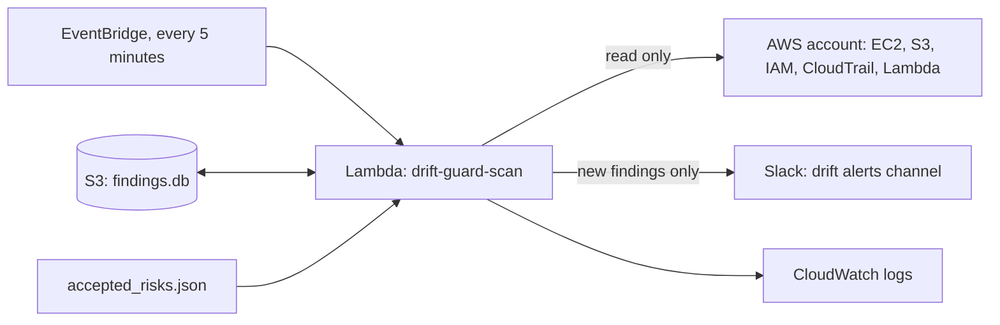

# Cloud Drift Guard

[](https://github.com/manaswichowdary/cloud-drift-guard/actions/workflows/ci.yml)

A scanner for an AWS account. It looks for security mistakes, wasted spend and drift (things that were
changed by hand after Terraform built them). It tells you what is wrong and how to fix it, alerts on
Slack only when something is new, and can open a pull request for the few fixes that are safe to automate.

I built it for small teams that do not have a cloud engineer.

**The problem.** Small teams make the same cloud mistakes (logging switched off, ports open to the internet, resources nobody remembers) and have nobody watching. Tools that do watch often send so many alerts that people stop reading them.

**The result.** On a real AWS account it caught 11 of 11 deliberately planted mistakes. Its first scheduled scan of my own account found 10 real issues; I fixed them, and the scan now reports 0 open findings, with 5 accepted risks written down with review dates. It runs on AWS Lambda every 5 minutes.

**One hard decision.** What may be fixed automatically and what should only alert. Only new findings send a Slack message, only two low risk fixes (S3 versioning and a password policy) can open a pull request, and the scanner's IAM role has an explicit list of read actions instead of a broad policy.

## What it checks

| Rule | What it looks for | Kind |
|---|---|---|
| S3-PUBLIC | Bucket open to everyone with public access not blocked | security |
| S3-VERSIONING | Bucket without versioning | security |
| S3-LOGGING | Bucket without access logging | security |
| SG-SSH-OPEN | SSH (port 22) open to the internet | security |
| SG-ALL-OPEN | Every port open to the internet | security |
| SG-DEFAULT-RULES | Inbound rules on the default security group | security |
| EBS-UNENCRYPTED | Unencrypted volume | security |
| IAM-ADMIN-USER | User with a policy that allows every action on every resource | security |
| IAM-NO-MFA | Console user without MFA | security |
| IAM-OLD-KEY | Active access key older than 90 days | security |
| LAMBDA-OLD-RUNTIME | Function on a retired runtime | security |
| ACCT-NO-PW-POLICY | No IAM password policy | security |
| ACCT-ROOT-KEY | Root user has an access key | security |
| ACCT-NO-CLOUDTRAIL | No CloudTrail trail | security |
| EBS-UNATTACHED | Volume attached to nothing | waste |
| EIP-UNUSED | Elastic IP attached to nothing | waste |
| EC2-IDLE | Running instance under 5% CPU for 7 days | waste |
| COST-JUMP | Daily spend up 1.5x or more against the week before | waste |
| DRIFT | Security group rules, volume size or encryption, instance type or bucket versioning differ from the Terraform state, or the resource was deleted | drift |
| DRIFT-UNTRACKED | A security group, volume, instance or bucket exists in AWS but not in Terraform | drift |

Each rule is a small function in `scanner/rules/` with its own test.

## How it fits together

```
scan or schedule -> rules, drift check and cost check -> findings table (SQLite)
                 -> new findings only -> Slack alert
                 -> safe findings -> pull request with Terraform fix files
```

The findings table is what keeps alerts rare. A finding is sent once, again only if it was fixed and came back.

On AWS, the scheduled version looks like this:



## Try it without touching a real account

The sample environment in `terraform/` plants 12 mistakes on purpose. You can run it against a fake AWS (a moto
server that runs on your machine, free and with no account), so nothing is created in a real account.

```
pip install -r requirements-dev.txt
make test                 # all tests, no AWS needed
make moto-up
make tf-init
make tf-apply-local       # plants the 12 mistakes
make measure-local        # scans, then prints "Caught N of 12 planted mistakes."
make drift-local          # compares Terraform state with what is in the fake account
make moto-down
```

The tests run the same measurement on an emulated account (`tests/test_planted_issues.py`): 12 planted mistakes,
all found, and no findings on the correctly configured resources.

## Using it on a real account

The scanner only reads. Give it a read only role (the AWS managed `SecurityAudit` and `ViewOnlyAccess` policies should
cover the rules, plus `ce:GetCostAndUsage` for cost).

```
python -m scanner.cli scan --json findings.json
python -m scanner.cli scan --slack          # needs SLACK_WEBHOOK_URL
python -m scanner.cli drift                 # runs terraform show -json in ./terraform
python -m scanner.cli cost                  # one Cost Explorer call, about one cent
python -m scanner.cli fix-pr --repo owner/name          # dry run
python -m scanner.cli fix-pr --repo owner/name --open   # needs GITHUB_TOKEN
```

To plant the mistakes on real AWS, set `name_suffix` to something unique such as `-<your account id>`, and set
`plant_old_lambda=false`, because AWS stops allowing new functions on retired runtimes. Destroy it with
`terraform destroy` when you are done. Everything in the sample environment is free or a few cents.

## Results on a real AWS account

I ran this against a real AWS account (a new account on the free plan, us-east-1) using a read only user.

- **Before planting anything**, the scan found 5 real issues in the fresh account: no CloudTrail trail, no IAM
  password policy, inbound rules on the default security group, and a SageMaker bucket with no versioning or access
  logging.
- **Planted mistakes:** Terraform created 22 resources, 11 of them deliberate mistakes. The scanner caught
  **11 of 11**. The twelfth planted mistake, a function on a retired runtime, is skipped on real AWS because AWS
  refuses to create one.
- **Waste:** it flagged about $3.73 a month. That matches the unused Elastic IP ($3.65) plus a 1 GB unattached
  volume ($0.08).
- **Drift:** I opened SSH to the whole internet on a security group by hand in the console. The drift check flagged
  it as high severity and sent a Slack alert. I ran the check by hand about a minute after the change, so this shows
  that detection works, not how fast a schedule would catch it. It also flagged a bucket that exists in AWS but not
  in Terraform, which was a true finding (the SageMaker SDK created it).
- **Timing and the full incident:** with a scan running every 60 seconds from a timer on my laptop, I added an "all
  traffic from anywhere" rule to a security group at 17:46:08. The next scan found it 10 seconds later and the Slack
  alert arrived in the same minute. That was lucky timing: a scan takes about 25 seconds, so the worst case is about
  85 seconds. I fixed it with `terraform apply` at 17:48:34 and the next scan confirmed it, 14 seconds later. The write
  up is in `docs/postmortem.md` and the response steps are in `docs/runbook.md`.
- **Slack:** a real alert with the new findings arrived in a channel. A repeat scan with nothing changed reported 0 new findings, so there was nothing to send.
- **Fix pull request:** it opened a real pull request with two safe fixes (S3 versioning and a password policy)
  against a separate demo repo: https://github.com/manaswichowdary/drift-guard-demo-infra/pull/1
- **Cost Explorer:** the real call works. On the first try, minutes after switching Cost Explorer on, AWS returned
  "data not available", which the tool now reports as a clear message. Once the data filled in, the real call
  returned no unusual spend jump. This account spends close to nothing, so that shows the call and permissions work,
  not that the spike detection has caught a real spike. That logic is covered by tests.

## Decisions I made

**Which fixes run automatically.** Only three rules get an automatic pull request: S3 versioning, S3 public access
block and an IAM password policy. Each one only adds protection and cannot lock anyone out or delete data. Closing
an SSH rule could cut off a person who needs it, and deleting a volume loses data, so those only alert.

**Smallest permissions.** The scanner needs read access only. It never changes anything in AWS. The fix pull
request is the only write, and it goes to GitHub, where a person reviews it.

**Keeping alerts rare.** Findings are stored, and only new ones are sent. A Slack message is capped at 10 lines and
sorted worst first. Cost jumps need at least $1 a day, so a change from 2 cents to 5 cents does not page anyone.

**Waste estimates are rough.** Unused volumes are priced at gp3 list price and unused Elastic IPs at the public IPv4
hourly rate. Idle instances are flagged but not priced.

## Results on a fake AWS (moto)

Run against a fake AWS (moto server), with the Terraform sample environment applied:

- **Planted mistakes caught:** 12 of 12 (`make measure-local`).
- **Drift:** with nothing changed, 0 findings. After adding an inbound rule by hand, 1 finding that shows the rule
  Terraform expected against the rules AWS has.
- **Tests:** 48 passing. They include the same 12 planted mistakes on an emulated account, with no findings on the
  correctly configured resources.

The scan also reports 4 findings I did not plant, all true: no CloudTrail trail, no password policy, and the log
bucket itself has no versioning or access logging.

Not measured yet: false alerts per week over a long run. The time from a change to an alert was measured once on the
real account (see the section above).

## Scheduled scan on AWS

The scan now runs on its own as an AWS Lambda function (`drift-guard-scan`), started by EventBridge every 5 minutes.
`deploy/deploy_aws.py` creates everything: the function, a read only role, the schedule, and a private versioned S3
bucket that holds the findings table between runs. It is safe to run again, and a redeploy keeps the saved Slack
webhook.

- **Alerts:** a Slack message goes out only when a finding is new. A repeat scan with nothing changed stays quiet.
  If one of the rules fails to run, that also alerts, and the function reports an error so it shows up in AWS.
- **Permissions:** the role has an explicit list of read actions, not a broad policy. A test checks that every call
  the rules make is on that list, so a new rule cannot quietly need more access.
- **First real run:** the first scheduled scan found 10 findings in my account. I fixed the real ones: I created a
  multi region CloudTrail trail with its own log bucket and log file validation, set an IAM password policy, turned
  on versioning for two SageMaker buckets, and removed an open rule from the default security group. The scans after
  that went 10, then 6 (5 resolved, 1 new from the log bucket I had just created), then 0 open.
- **Accepted risks:** `scanner/accepted_risks.json` lists findings I chose to accept, each with a reason and a review
  date. Right now that is S3 access logging on 5 buckets (it would need yet another bucket to hold the logs). Accepted
  findings are counted but do not alert, and they come back automatically once the review date passes.
- **Limits:** the EC2 checks cover us-east-1 only. Cost Explorer and the Terraform drift check are not in the
  schedule: Cost Explorer charges for every request, which would be about $86 a month at one call every 5 minutes.
  If a deploy and its first scan overlap with the first scheduled scan, two scans can run at once and send a
  duplicate alert. That happened once and is harmless. I have not measured how long an alert takes on this schedule.

## Status

- Done: 17 security and waste rules, drift check, cost jump check, findings table, Slack alert format, safe fix
  proposals, pull request opener, Terraform environment with planted mistakes, measurement tool, CI, a runbook, a
  postmortem for one simulated incident, a scheduled scan workflow (GitHub Actions, now switched off), and a scheduled scan on AWS Lambda with EventBridge (see the scheduled scan section above).
- Run on a real AWS account: 11 of 11 planted mistakes caught, a real Slack alert, a real fix pull request, and real
  drift caught. Details are in the results section above.
- GitHub schedule result: the workflow is set to run every 5 minutes, but GitHub ran it only about 4 times a day. The
  first run came 6 hours 41 minutes after I pushed it, the typical gap was about 6.3 hours, the longest gap was about
  10.6 hours, and none of the 22 runs failed. GitHub's free scheduler is best effort, so I switched it off. The 85
  second alert time above came from a scan loop on my laptop, not from this schedule.
- Not in the AWS schedule: Cost Explorer, the Terraform drift check, and regions other than us-east-1. They still run by hand from the command line.

## What I would do next

- Scan regions other than us-east-1. The EC2 checks only look at one region today.
- Run Cost Explorer and the Terraform drift check once a day. Cost Explorer charges per request, so a 5 minute schedule would cost about $86 a month.
- Measure how long a change takes to reach Slack on the Lambda schedule. I measured 10 seconds with a loop on my laptop, but not on Lambda.
- Stop two overlapping scans from sending a duplicate alert. It happened once, right after a deploy.
- Record a 90 second demo: change a security group, watch the alert arrive in Slack, then fix it.
